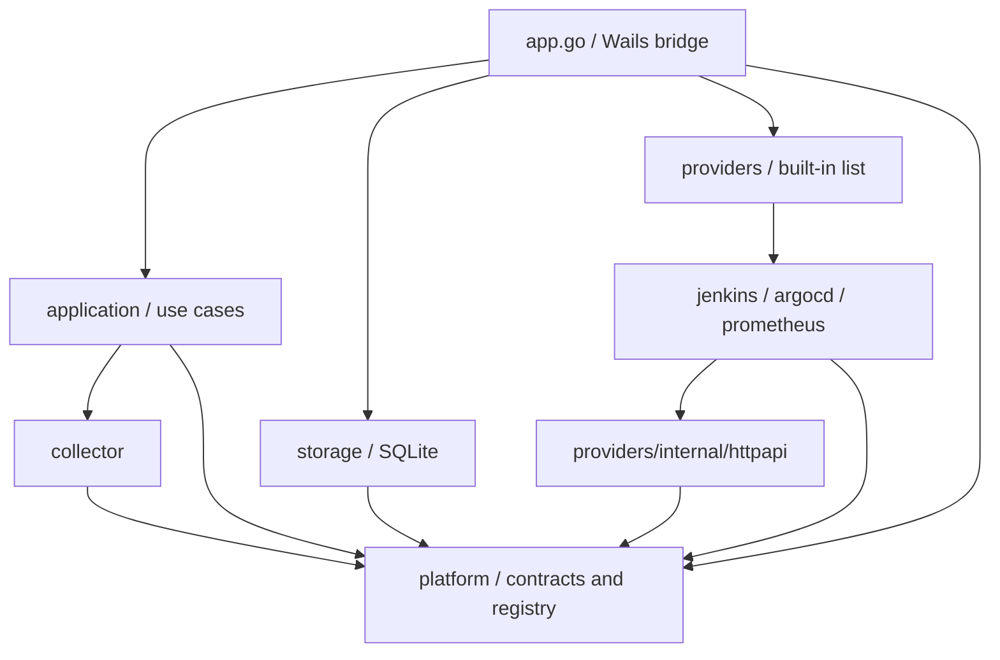

# Architecture and extension boundaries

The application composes capabilities instead of inheriting a universal data class. A time series, a build execution, and a deployment snapshot have different identity and retention semantics. Flattening them into an untyped payload would move those differences into every caller.

## Repository layout

```text
dashboard/
├── main.go                      # Wails entry point and window setup
├── app.go                       # Composition root, Windows credentials, Wails dialogs/bridge
├── internal/
│   ├── application/             # Shared use cases, lifecycle, storage/credential ports
│   ├── platform/                # Shared models, capability interfaces, registry, validation
│   ├── collector/               # Polling policies; depends on capability and archive contracts
│   ├── storage/                 # SQLite settings, build archive, preferences, backup
│   ├── providers/
│   │   ├── builtin.go           # Explicit list of shipped provider definitions
│   │   ├── jenkins/             # API translation, metadata, fixture tests
│   │   ├── argocd/              # API translation, session authentication, fixture tests
│   │   ├── prometheus/          # API translation, PromQL presets, fixture/live tests
│   │   └── internal/httpapi/    # Transport shared only within providers
│   ├── demo/                   # Synthetic HTTP services and integration smoke test
│   └── architecture/           # Production import-boundary regression test
├── frontend/src/
│   ├── main.ts                 # Navigation, page state, rendering and event coordination
│   ├── bridge/                 # Wails access, bridge contract, browser fixture
│   ├── components/chart.ts     # Numeric-series rendering and chart lifecycle
│   ├── shared/                 # Data contracts and display formatting
│   └── style.css
├── frontend/tests/             # Browser acceptance tests
├── examples/                   # User configuration guidance
└── scripts/                    # Repeatable build and test commands
```

These are Go **packages inside one module**, with one root `go.mod`. Each adapter owns its implementation, metadata, and tests. Adding a tool does not require another repository, module, or executable.

## Dependency direction

Arrows mean “imports”; `app.go` is the composition root. The application package is independent of Wails, concrete storage, keyring, and built-in providers.



- `platform` uses only the standard library. It cannot import providers, SQLite, or Wails.
- `application` imports only the standard library, `platform`, and `collector`. It owns the `Store` and `Credentials` ports; tests supply a temporary SQLite store and fake credentials. CLI/MCP adapters can call the same service without importing Wails. No CLI/MCP server is included.
- `collector` imports `platform` and the standard library. Its `BuildArchive` interface requires only `Known`, `SaveBuilds`, and `Running`; `application` passes its store port, and `app.go` supplies SQLite to that port.
- `storage` knows the shared data models, but not providers or collection scheduling.
- Each provider imports the contracts and optionally the shared HTTP client. Providers do not import one another, the collector, or storage.
- `providers/builtin.go` owns the shipped registration list. A provider's `Definition()` owns metadata, construction, and optional provider-specific connection validation.
- The frontend's `bridge/index.ts` selects Wails or the browser fixture. Charts consume normalized numeric series, without querying upstream APIs.

`internal/architecture/boundaries_test.go` checks production Go imports during `go test ./...`. Integration tests may compose multiple layers. Go's nested `internal` directory also prevents packages outside `providers` from importing its HTTP helper.

The current extension model is **source contributions compiled with the app**. Go's `internal/platform` is a contract for packages in this repository, not a separately versioned public SDK or runtime plugin API. An independently distributed plugin SDK would need an explicit compatibility and loading design.


## Data contracts

| Capability | Contract / normalized data | Identity and time | Storage |
| --- | --- | --- | --- |
| Build executions | `BuildSource` → `Build` | Connection + target + numeric build number + start time; milliseconds | SQLite archive; duplicate observations upsert |
| Queue | `QueueSource` → `QueueItem` | Current queue item and target; queued-at milliseconds | Latest snapshot in memory |
| Deployments | `DeploymentSource` → `Deployment` | Stable source ID, revision(s), independent sync/health and operation state | Latest snapshot in memory |
| Time series | `MetricSource` → `QueryResult` → labelled `Series` → `Point` | Label set + timestamp in Unix seconds; nullable numeric value | Queried from upstream; not a local metrics warehouse |

`Provider` supplies connection checking. `TargetDiscoverer` optionally supplies target discovery. `TestConnection` returns `{targets, discovery, warning}`: discovery is `complete`, `unsupported`, or `failed`. A failed probe is still an error; a successful probe with denied discovery retains that distinction. The editor preserves selected targets and accepts a directly entered target ID. Implement any combination of capabilities. For example, a build-only service does not need a fake queue method. A platform exposing both deployments and metrics implements both contracts; both are collected unless its descriptor sets `OnDemand: true`. An on-demand connection creates no background provider instance, request, or archive write, including on Refresh; explicit Query and TestConnection remain available. `CI`, `CD`, and `Monitoring` remain compatibility names for existing callers.

Targets may declare `capabilities`. A combined provider can return one target for `builds` and another for `deployments`, preventing deployment identifiers from being passed to build endpoints. An empty capability list retains the legacy behavior for single-purpose providers.

## Responsibilities

- `platform/model.go` defines normalized DTOs and independent capabilities. `registry.go` checks registration and interface/metadata consistency; `validation.go` checks shared connection fields.
- `collector/collector.go` orchestrates one connection. `collect_builds.go`, `collect_queue.go`, `collect_deployments.go`, and `collect_metrics.go` own their respective collection policies.
- `storage/sqlite.go` owns the unchanged archive schema, connection settings, preferences, and backup behavior.
- `providers/<name>` owns API paths, response decoding, platform authentication, supported configuration, and tests. PromQL presets live in `providers/prometheus/presets.go`.
- `application.Service` owns configuration changes, credential bindings through a port, admission, polling, manual operations, snapshots, history, preferences, and backup use cases.
- `app.go` owns service composition, OS credential access, the database path, demo startup, native dialogs, window geometry, and explicit Wails forwarding methods.
- `platform/persistence.go` contains storage-neutral record/filter/page DTOs. Storage aliases preserve existing Go callers; SQL, schema version, archive key, remain unchanged. Connection JSON now supports tenant and schemaVersion; unknown fields are preserved when editing.

Provider identity does not select collection policy: implemented interfaces select capabilities. Protocol-specific validation uses the optional `Definition.Validate` callback; Argo CD local-account username validation lives with Argo CD. Authentication protocol implementation is still required when introducing a new authentication method.

## Failures and freshness

Each snapshot contains `modules[capability]` with `attempted`, `lastSuccess`, and `error`. A deployment failure does not mark a successful metrics or build response as failed. The aggregate error remains available for the connection banner, while rule freshness uses the metrics module. Published snapshots are deeply copied, including labels, sample values, warnings, and deployment revisions. Providers may reuse result memory on a later call, but must not mutate it concurrently with return/serialization. Callers cannot mutate the retained snapshot through GetState or Poll. Registry metadata and connection slices are also copied at ownership boundaries.

Capabilities run serially with a 12-second budget each inside a 60-second connection cycle. Queue time counts toward the cycle and manual-query deadline. Admission allows two operations globally and one per connection; a per-connection waiter does not hold a global slot. Cancellation remains cooperative. There is no distributed scheduler or background service.

Query text is interpreted by the adapter. The frontend uses declared language, default expression, and presets, and separates favorites by language. It renders normalized numeric series without parsing PromQL or SQL. The SQL fixture is an extension test, not an implemented SQL monitoring backend.

## Proven extension path

`collector/extensibility_test.go` is in the external `collector_test` package. It implements a combined provider using only public contracts, registers it through `Definition`, and collects builds, deployments, and synthetic SQL-shaped metrics without changing core collection code. The test checks target routing, absence of a queue, per-module failure isolation, immutable prior status, cancellation, and archive deduplication.

The browser suite independently injects a new provider name and SQL query metadata. It verifies the default expression, query execution, and the coexistence of target selection and metric-rule editing. These are contract proofs, not claims that a real fourth vendor has been integrated.

## Remaining boundaries

The first modularization deliberately preserves the existing SQLite format and historical collection algorithm. Build identifiers are still positive integers; pages are newest-first groups of 100 addressed by offset, with overlapping historical reads. A UUID-only build API or cursor-only pagination still needs a contract/storage change. Do not hash an opaque ID into a number or invent a start time to fit this contract.

A new build identity and provider-owned cursor remain design work. Decimalizing a numeric ID alone does not establish stable execution identity across attempts or reused numbers. Choose and validate a second CI's actual semantics before changing the archive key. No migration has been applied; an old executable is not a database downgrade strategy.

Logs and traces now have independent typed contracts and bounded on-demand explorers. Alerts, DORA calculations, and metrics retention remain unimplemented. Page rendering and event coordination remain in `frontend/src/main.ts`; the bridge, shared contracts/formatters, and chart component are separate modules. Existing capabilities can be extended without adding vendor-specific frontend polling. A new data capability still needs an explicit UI and collection contract.


## Accepted runtime decisions (2026-10-13)

This implementation adopts the application boundary, optional discovery, explicit on-demand policy, ownership copies, and cooperative lifecycle portions of the design brief. It does not mark all 22 proposed invariants as implemented.

- Keep typed observations and compiled-in definitions. Loki and Tempo are additional compiled-in adapters. A dynamic schema engine, public SDK, and subprocess runtime remain outside this implementation.
- Assign a fresh opaque runtime revision to each configured connection lifecycle. Edits, deletion, and credential replacement cancel the old lifetime. Failed persistence restarts the previous configuration under a fresh lifetime. Revision is visible in ConnectionView but is not a stored schema version.
- Polling owns one provider per connection lifetime; manual Query/TestConnection owns one provider per operation. Each closes an optional `io.Closer` after its last call. Built-in closers close idle HTTP connections. Failed registry capability validation also closes the constructed provider.
- Query and TestConnection register with the host before acquiring the two-slot gate. Their 8/45-second deadlines include queue time; provider creation and credential access happen after admission. Poll has a 60-second cycle budget including queue time and each module has 12 seconds. Load-based fairness and target-level fan-out budgets remain separate work.
- Close rejects new operations, cancels both polling and manual operations, waits for them, then closes storage. Cancellation is cooperative: in-process factories, credential calls, Close methods, and providers must finish; a provider that ignores cancellation can still delay shutdown.
- Cancelled manual operations discard both successful results and provider errors from the old lifetime. Poll publication checks the active runner. The UI also checks request/generation and connection state for late success and failure. Range chart cache has a 30-second TTL and 32-entry cap, includes connection revision/configuration, and checks validity before inserting results.
- TestConnection's structured result is a coordinated Go/TypeScript/preview wire change. Existing native consumer code must be rebuilt with this release. Archive wire shapes are retained; new log/trace methods use independent typed envelopes.

Regression evidence lives in `internal/application/service_test.go`, `internal/collector/ownership_test.go`, `frontend/tests/provider-lifecycle.spec.ts`, and the application import-boundary check. Tests use synthetic providers/local data, not live vendor acceptance or an independent SDK.

Still open: target-level partial outcomes and migration of existing sources to common envelopes; build identity/cursor semantics and schema migration; orphan credential cleanup after OS-store failures; dynamic configuration schema UI; and full secret redaction of arbitrary third-party diagnostics. The current numeric build/offset and Argo-shaped deployment limitations remain explicit.


## Log and trace observations (2026-10-13)

`LogSource` and `TraceSource` are independent of `MetricSource`. Each ships with a separate adapter package, static descriptor, HTTP fixtures, and an on-demand UI. `application/observations.go` stamps connection/revision/request/window/observation time and returns typed outcome/completeness/diagnostics alongside rows. Search windows use epoch seconds; event ns, trace/span IDs, and OTLP int64 values stay strings. Returned maps, slices and raw attribute bytes are copied.

Loki retains labels, structured metadata, duplicate lines and equal timestamps. Search is capped at 500 rows and 24 hours. It does not implement tail or a synthetic timestamp cursor. Tempo searches at most 100 summaries and reads at most 2000 spans per detail response. Detail lookup omits search-window filters, accepts both Tempo `batches` and OTLP `resourceSpans`, normalizes base64/hex IDs, and preserves original span/scope fields. Neither sampling completeness nor missing-parent root status is inferred. Shared transport still limits responses to 8 MiB.

Connection JSON schema 0 (legacy) and 1 are accepted; saves write 1. Storage edits preserve unknown top-level fields and target/rule fields matched by ID, without exposing unknown settings to Desktop. Future connection schemas are readable but cannot be opened or overwritten. SQLite remains schema v1; there is no archive migration. Tenant binding uses the same new-connection boundary as endpoint changes. See [feature status](FEATURE_SPEC_AND_STATUS.ko.md) for the full invariant and ADR mapping.
